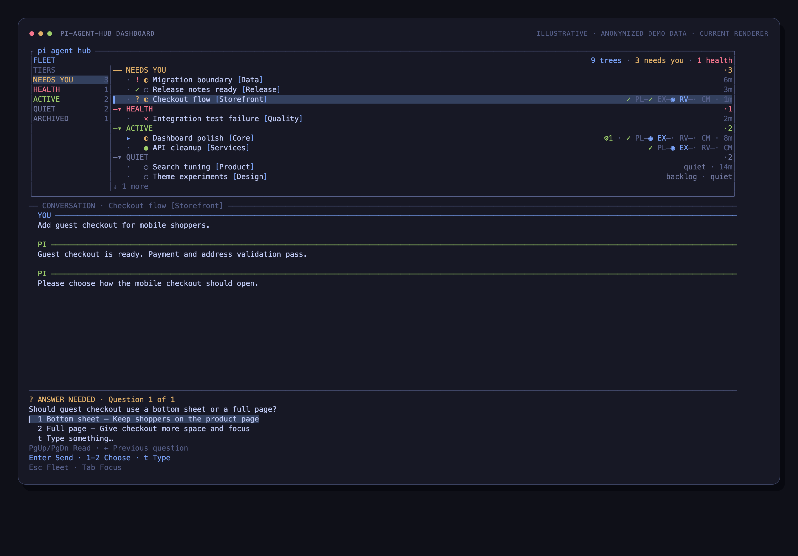

# pi-agent-hub

Pi-native tmux hub for long-running coding-agent sessions, skills, and MCP.

Use `pi-hub` to supervise agents, answer questions, and reply from one session list. Open Pi when you need to work inside a session.

New here? See [Features](docs/FEATURES.md) for the daily workflow and full key map.



*Current dashboard renderer with example sessions. Ticket, request, and workflow context comes from optional Pi extensions.*

## Why pi-agent-hub?

Pi runs the agents. tmux keeps them alive. Hub gives you one keyboard-driven dashboard without replacing either.

| Feature | Why it matters |
| --- | --- |
| Attention-first dashboard | Find explicit requests, runtime errors, active work, and quiet sessions in separate sections. |
| Repository view | Group sessions by their source repo, including worktrees and multi-repo sessions. |
| Pinned live sessions | Keep up to four Pi sessions beside the dashboard and focus them by number. |
| Actions and search | Find sessions, send a message, or run an action without leaving the dashboard. |
| Card answers and replies | Answer supported questions with `Tab`, or write a reply with `p`. |
| Conversation | Read completed messages and question/answer history below the fleet. |
| Optional workflow board | See workflow position, task progress, and nested subagents from compatible Pi extensions. |
| Project skills and MCP | Choose capabilities for the selected session's primary repo. |
| Multi-repo workspaces | Give one session access to several repos without moving the source folders. |
| Hub-owned worktrees | Create isolated branch sessions and explicitly finish, forget, or discard them. |
| Local and recoverable | No cloud service, custom agent runtime, or hidden repo scanning. Sessions remain normal tmux sessions. |

## Quick start

Requirements: Pi 0.99.x (0.99.2 minimum), Node.js 22.19+, and tmux 3.1+.

```bash
npm install -g pi-agent-hub
pi-hub doctor
pi-hub
```

Press `n` to create a session. Use `]` for the next request, `Tab` Answer or `p` Reply, then `]` to move on.
Use `Enter` to open Pi, `Ctrl+Q` to return, and `i` for Details. Inside Pi, `Alt+W` opens the next request.

| Key | Action |
| --- | --- |
| `n` | Create a Pi session |
| `Enter` | Open/switch to the selected session, or restart it if stopped |
| `Ctrl+Q` | Return from a managed session or live pin |
| `1`–`4` / `P` | Pin into an exact free slot / the first free slot |
| `Alt+1`–`Alt+4` | Focus an occupied pin |
| `x` | Close the selected session's pin without stopping Pi |
| `/` / `:` | Filter sessions / search actions, sessions, and filters |
| `]` / `Tab` | Select the next request / answer a supported question on its card |
| `p` | Reply on the selected live parent's card, using Send, Steer, or Queue |
| `c` | Show or hide the selected live session's Conversation panel |
| `i` | Toggle Details inside the selected card |
| `v` / `S` | Switch Status/Repo view / visit the workflow board |
| `←` / `→` | Collapse / expand a subagent tree; use `Shift+←` / `Shift+→` for all trees |
| `r` / `R` | Restart choices / rename |
| `f` / `F` | Fork / fork and compact |
| `g` / `G` | Move a session to a group / rename its group |
| `A` / `B` / `U` | Archive as Done, Abandoned, or archive only / move to Backlog / restore or reopen |
| `s` / `m` | Pick project skills / MCP servers |
| `t` | Choose a theme |
| `?` / `q` | Help / quit the dashboard |

See [Dashboard keys](docs/FEATURES.md#dashboard-keys) for all controls.

The default Status view puts explicit requests in `NEEDS YOU`, runtime errors in `HEALTH`, new or forked sessions you have not opened yet in `NEW`, running work in `ACTIVE`, and other sessions in `QUIET`. `ARCHIVED` is newest-first. Waiting alone does not mean an agent needs an answer. Explicit requests require an extension that reports them.

Each parent session shows its `[group]` after the title. Press `v` to browse by repository instead. Worktrees stay with their source repo; multi-repo sessions appear under their primary repo. Groups and Backlog/Archive organize sessions without stopping their agents.

`A` opens Archive session: `d` marks Done, `x` marks Abandoned, `a` archives without an outcome, and `Esc` cancels. Archive never stops Pi or completes its workflow. `U` reopens a closed session; `A` and `B` require reopening first. See [Session closure](docs/FEATURES.md#session-closure) for archived icons and conversation behavior.

The selected fleet card expands in place with task context, the request, and actions. `i` toggles Details at every width. Only the workflow board keeps a side panel or a full-width view below 120 columns. `Enter` and double-click open Pi directly. Card context comes from producer metadata, never raw pane output or conversation search.

Press `Tab` to answer a supported question on its card. Unsupported prompts offer **Open in Pi**. Press `c` for read-only completed messages and question/answer history below the fleet. Conversation does not store a second transcript or search message content. See [Answer from a card](docs/FEATURES.md#answer-from-a-card) and [question integration](docs/CONFIG.md#inline-questions).

Pins and follow view are opt-in. Use `o` for a pane that follows selection, or `P` to pin a live session beside the dashboard. Terminals 100–159 columns wide support two slots; wider terminals support four. An occupied slot is never replaced. `Alt+1`–`Alt+4` focuses a pin, `Ctrl+Q` returns, and `+` / `-` adjusts the split. `Alt+Q` stays available to Pi for editing the last message.

Press `:` to find an action or session. Selecting a session result reveals it without opening or marking it read. Fresh explicit requests also produce a short notification; select **Locate newest request** to find one, or **Attention bell** to enable the optional sound.

New sessions start as `New · repository`; forks start as `Fork · source name`. You can rename an unlinked session with `R` or use `Alt+R` from inside it. With Rules installed, a linked ticket supplies the session name. See [Session names](docs/FEATURES.md#session-names).

### Optional Pi integrations

Hub works on its own. Pi extensions can add task context, explicit requests, workflow progress, and subagent rows.

- [Rules](https://github.com/masta-g3/rules) supplies skills and a workflow runtime for Plan → Execute → Review → Reflect → Commit. Hub displays its ticket context, requests, and progress. Press `S` for the read-only workflow board.
- [`@juicesharp/rpiv-ask-user-question`](https://www.npmjs.com/package/@juicesharp/rpiv-ask-user-question) 2.15.0+ enables card answers through its official events. See [Inline questions](docs/CONFIG.md#inline-questions) for installation.
- [pi-tmux-subagents](https://github.com/masta-g3/pi-tmux-subagents) runs child agents in tmux. Hub shows them under their parent session.
- Your own Pi extensions can publish the supported context and workflow metadata. Configured dashboard shortcuts can send Pi commands to the selected session.

These integrations use Pi's extension system, not a separate Hub plugin loader. Hub displays workflow state; it does not run or advance the workflow. See [Optional integrations](docs/CONFIG.md#optional-integrations) for setup, prerequisites, and the metadata contracts.

## Install

The npm package is `pi-agent-hub`. It exposes `pi-hub` for daily use and `pi-agent-hub` as an alias.

```bash
npm install -g pi-agent-hub
```

If you also install or update through Pi with `pi install npm:pi-agent-hub`, Pi keeps a separate package copy under `~/.pi/agent/npm/node_modules/pi-agent-hub`. An older global npm command earlier on `PATH` can still launch the stale dashboard. Run `pi-hub doctor` after installing or updating and check any `cli package` warning.

POSIX shell fix:

```bash
mkdir -p ~/.local/bin
ln -sf ~/.pi/agent/npm/node_modules/.bin/pi-hub ~/.local/bin/pi-hub
# Put ~/.local/bin before the global npm bin in PATH.
```

On Windows PowerShell, the Pi package bin directory is:

```powershell
$PiBin = "$env:USERPROFILE\.pi\agent\npm\node_modules\.bin"
# Put $PiBin before the global npm prefix in your user PATH.
# Or run: & "$PiBin\pi-hub.cmd" doctor
```

Hub still requires tmux and a compatible shell environment. For local development, see [Development](docs/DEVELOPMENT.md).

## Common commands

```bash
pi-hub              # create, attach, or switch to the dashboard
pi-hub tui          # run directly in the current terminal
pi-hub doctor
pi-hub list
pi-hub explain <session-id-or-unique-prefix>
pi-hub add . -g default
pi-hub add ./api --add-cwd ../web --add-cwd ../shared
pi-hub delete <session-id>
pi-hub mcp-pool      # run the pooled MCP socket daemon
pi-hub config get
pi-hub config set session-prelude '<shell snippet>'
pi-hub config unset session-prelude
pi-hub config set worktree-default true
pi-hub config unset worktree-default
```

`explain` reports the live evidence behind a session's runtime status and dashboard placement without changing registry state.

`add --add-cwd` creates a symlink workspace for multiple repos. Skills and MCP stay attached to the primary repo.

For an isolated branch, enable Worktree with `Ctrl+T` in the new-session form and enter a branch name. Press `w` to finish a clean worktree session, merge its branch into the recorded base branch, and remove its worktrees. Use `d`, then `D`, to discard clean worktrees and branches without merging. Both require clean worktrees; finish also requires clean base repos.

Normal `delete` stops the session and removes Hub records and its symlink workspace. It keeps Pi conversation files, source repos, and hub-owned worktree directories. Archive and Backlog do not stop Pi; archiving also closes the session's pin. See [Worktree model](docs/FEATURES.md#worktree-model) for the full safety rules.

## Troubleshooting

Hub enables tmux mouse mode for the dashboard session while it runs, then restores your global preference on quit. For SSH use, mouse handling comes from the remote tmux server.

For better modified-key handling, enable extended keys globally if your tmux version supports it:

```tmux
set -g extended-keys on
```

Use `Alt+1`–`Alt+4` to focus pins. `Alt+←`/`Alt+→` is an optional spatial alias, but terminals can consume these keys for word movement. Hub leaves `Alt+↑`/`Alt+↓` to Pi, which uses `Alt+↑` to edit queued messages. Numeric focus or tmux prefix plus arrows avoids that conflict.

## Documentation

- [Features](docs/FEATURES.md): daily workflow, keys, session organization, pins, and worktrees.
- [Configuration](docs/CONFIG.md): optional integrations, global config, themes, skills, MCP, and state paths.
- [Development](docs/DEVELOPMENT.md): local setup, tests, package checks, and release workflow.
- [Structure](docs/STRUCTURE.md): project layout and architecture for contributors.
- [Changelog](CHANGELOG.md): release changes.

## Acknowledgements

Thanks to [Ashesh Goplani](https://github.com/asheshgoplani) for [Agent Deck](https://github.com/asheshgoplani/agent-deck). This project ports its core session-dashboard idea into a smaller Pi-native extension. It is not affiliated with Agent Deck. See `LICENSE` for the Agent Deck MIT notice.
