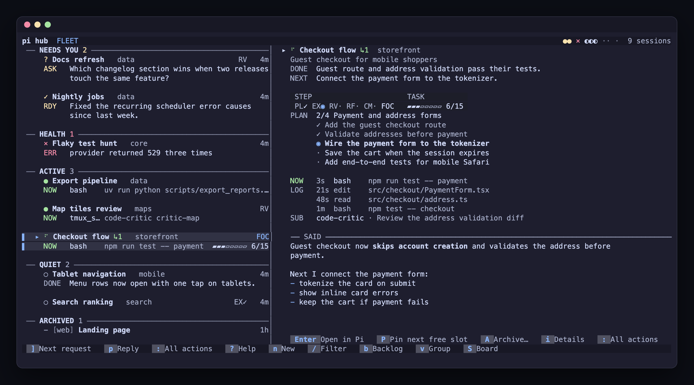
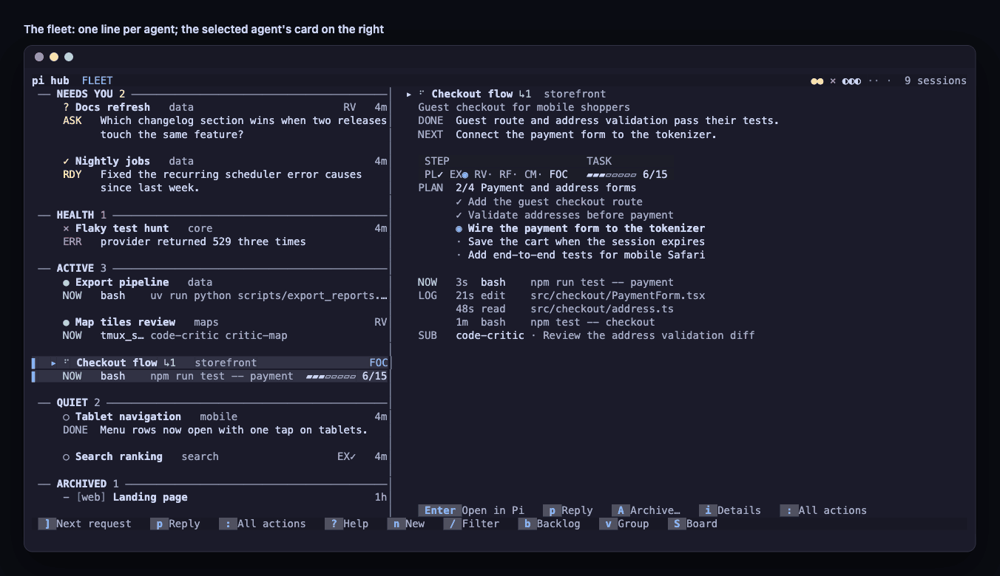

# pi-agent-hub

Pi-native tmux hub for long-running coding-agent sessions, skills, and MCP.

Use `pi-hub` to watch your agents, answer their questions, and reply to them from one session list. Open Pi only when you need to work inside a session.

New here? [Features](docs/FEATURES.md) has the daily workflow and the full key map.



*The dashboard at 150 columns, with example sessions. Every agent gets a line on the left. The selected agent's card is on the right. Tickets, requests, plans, and workflow steps come from optional Pi extensions.*

## Why pi-agent-hub?

Pi runs the agents. tmux keeps them alive. Hub adds one keyboard-driven dashboard and replaces neither.

| Feature | What you get |
| --- | --- |
| Attention-first dashboard | Requests, errors, running work, and quiet sessions each get their own section. |
| Repository view | Group sessions by their source repo, including worktrees and multi-repo sessions. |
| Pinned live sessions | Keep up to four Pi sessions beside the dashboard and focus them by number. |
| Actions and search | Find a session, send a message, or run an action from the dashboard. |
| Live agent card | See the selected agent's plan checklist, current and recent tool calls, and latest message without opening it. |
| Card answers and replies | Answer supported questions with `Tab`, or write a reply with `p`. |
| Conversation | Read completed messages and question/answer history below the fleet. |
| Phone inbox | Answer and reply from a phone browser with `pi-hub web`. Each new request sends a notification. |
| Optional workflow board | See workflow position, task progress, and nested subagents from compatible Pi extensions. |
| Usage and account quotas | Press `u` for token/cost history and account limits from an optional producer. |
| Project skills and MCP | Choose capabilities for the selected session's primary repo. |
| Multi-repo workspaces | Give one session access to several repos without moving the source folders. |
| Hub-owned worktrees | Start a session on its own branch, then finish, forget, or discard it. |
| Local and recoverable | No cloud service, no custom agent runtime, no repo scanning. Sessions stay normal tmux sessions. |

## Quick start

Requirements: Pi 0.99.x (0.99.2 minimum), Node.js 22.19+, and tmux 3.1+.

```bash
npm install -g pi-agent-hub
pi-hub doctor
pi-hub
```

Press `n` to create a session. Use `]` for the next request, `Tab` Answer or `p` Reply, then `]` to move on.



Use `Enter` to open Pi, `Ctrl+Q` to return, and `i` for Details. Inside Pi, `Alt+W` opens the next request.

| Key | Action |
| --- | --- |
| `n` | Create a Pi session |
| `Enter` | Open/switch to the selected session, or restart it if stopped |
| `Ctrl+Q` | Return from a managed session or live pin |
| `o` | Turn follow view on or off |
| `1`–`4` / `P` | Pin into an exact free slot / the first free slot |
| `Alt+1`–`Alt+4` | Focus an occupied pin |
| `x` | Close the selected session's pin without stopping Pi |
| `/` / `:` | Filter sessions / search actions, sessions, and filters |
| `]` / `Tab` | Select the next request / answer a supported question on its card |
| `p` | Reply on the selected live parent's card, using Send, Steer, or Queue |
| `c` | Show or hide the selected live session's Conversation panel |
| `i` | Toggle Details inside the selected card |
| `v` / `S` | Switch Status/Repo view / visit the workflow board |
| `←` / `→` | Collapse / expand a subagent tree; use `Shift+←` / `Shift+→` for all trees |
| `r` / `R` | Restart choices / rename |
| `f` / `F` | Fork / fork and compact |
| `g` / `G` | Move a session to a group / rename its group |
| `A` / `B` / `U` | Archive as Done, Abandoned, or archive only / move to Backlog / restore or reopen |
| `z` | Undo the last Backlog, Archive, Restore, Mark read, or group move |
| `s` / `m` | Pick project skills / MCP servers |
| `t` | Choose a theme |
| `u` | Open Usage: Cost, Tokens, and Limits |
| `?` / `q` | Help / quit the dashboard |

See [Dashboard keys](docs/FEATURES.md#dashboard-keys) for all controls.

The Status view sorts sessions into sections. `NEEDS YOU` holds explicit requests, `HEALTH` errors, `NEW` sessions you have not opened, `ACTIVE` running work, and `QUIET` the rest. A waiting agent is not a request. Requests come from an extension that reports them. See [Status vocabulary](docs/FEATURES.md#status-vocabulary).

Each agent gets a title line and at most one status line: its request, error, current tool call, or last progress note. The selected agent's card shows the full request, plan checklist, recent tool calls, and latest message. The card sits beside the list, or below it under 100 columns. The card never shows pane output or tool output. See [Details](docs/FEATURES.md#details).

Groups, Backlog, and Archive sort sessions but never stop an agent. Archiving also closes the session's pin. `v` groups sessions by repository instead of status. `A` archives a session as Done, Abandoned, or with no outcome. `U` reopens it, and `z` undoes the last move. See [Groups and session actions](docs/FEATURES.md#groups-and-session-actions).

Pins and follow view are opt-in. `P` keeps a live session beside the list, and `o` opens one pane that follows the selection. Hub never replaces a pin you already have. See [Sidebar workspace](docs/FEATURES.md#sidebar-workspace).

### Optional Pi integrations

Hub works on its own. Pi extensions can add task context, explicit requests, workflow progress, and subagent rows.

- [Rules](https://github.com/masta-g3/rules) adds skills and a Plan → Execute → Review → Reflect → Commit workflow. Hub shows its tickets, requests, and progress. `S` opens the read-only workflow board.
- [`@juicesharp/rpiv-ask-user-question`](https://www.npmjs.com/package/@juicesharp/rpiv-ask-user-question) 2.15.0+ lets you answer questions from the card. See [Inline questions](docs/CONFIG.md#inline-questions) to install it.
- [pi-tmux-subagents](https://github.com/masta-g3/pi-tmux-subagents) runs child agents in tmux. Hub shows them under their parent session.
- `pi-accounts` can publish quota readings and token/cost rollups through the [usage snapshot contract](docs/CONFIG.md#usage-snapshot). Header bars open Limits; `u` opens Usage. Cost estimates are API-equivalent, not your bill. Hub never reads conversations or credentials for this integration.
- Your own Pi extensions can publish the supported context and workflow metadata. Configured dashboard shortcuts can send Pi commands to the selected session.

These are ordinary Pi extensions. Hub has no plugin loader of its own. Hub shows workflow state but never runs or advances a workflow. See [Optional integrations](docs/CONFIG.md#optional-integrations) for setup, prerequisites, and the metadata contracts.

## Install

The npm package is `pi-agent-hub`. It exposes `pi-hub` for daily use and `pi-agent-hub` as an alias.

```bash
npm install -g pi-agent-hub
```

`pi install npm:pi-agent-hub` keeps a second copy under `~/.pi/agent/npm/node_modules/pi-agent-hub`. If an older global `pi-hub` comes first on `PATH`, it still starts the old dashboard. After each install or update, run `pi-hub doctor` and check for a `cli package` warning.

To fix the order in a POSIX shell:

```bash
mkdir -p ~/.local/bin
ln -sf ~/.pi/agent/npm/node_modules/.bin/pi-hub ~/.local/bin/pi-hub
# Put ~/.local/bin before the global npm bin in PATH.
```

On Windows PowerShell, the Pi package bin directory is:

```powershell
$PiBin = "$env:USERPROFILE\.pi\agent\npm\node_modules\.bin"
# Put $PiBin before the global npm prefix in your user PATH.
# Or run: & "$PiBin\pi-hub.cmd" doctor
```

Hub still needs tmux and a compatible shell. For local development, see [Development](docs/DEVELOPMENT.md).

## Common commands

```bash
pi-hub              # create, attach, or switch to the dashboard
pi-hub tui          # run directly in the current terminal
pi-hub doctor
pi-hub list
pi-hub explain <session-id-or-unique-prefix>
pi-hub add . -g default
pi-hub add ./api --add-cwd ../web --add-cwd ../shared
pi-hub delete <session-id>
pi-hub mcp-pool      # run the pooled MCP socket daemon
pi-hub web           # serve the phone inbox on 127.0.0.1
pi-hub config get
pi-hub config set session-prelude '<shell snippet>'
pi-hub config unset session-prelude
pi-hub config set worktree-default true
pi-hub config unset worktree-default
```

`explain` shows why a session has its status and section. It changes nothing.

`web` serves the [phone inbox](docs/FEATURES.md#phone-inbox) on localhost. Publish it to your phone with Tailscale Serve; see [Phone inbox setup](docs/CONFIG.md#phone-inbox).

`add --add-cwd` gives one session several repos through a folder of links. Skills and MCP stay with the primary repo.

For work on its own branch, press `Ctrl+T` in the new-session form and enter a branch name. `w` merges a clean worktree session into its base branch and removes the worktrees. `d`, then `D`, discards clean worktrees and branches without merging. Both need clean worktrees, and `w` also needs clean base repos.

`delete` stops the session and removes Hub's records and its link folder. It keeps Pi conversations, source repos, and worktree folders. See [Worktree model](docs/FEATURES.md#worktree-model) for the safety rules.

## Troubleshooting

Hub turns on tmux mouse mode while the dashboard runs and restores your setting when it quits. Over SSH, the remote tmux server handles the mouse.

If your tmux supports it, turn on extended keys for better handling of keys with `Alt`, `Ctrl`, or `Shift`:

```tmux
set -g extended-keys on
```

Use `Alt+1`–`Alt+4` to focus pins. `Alt+←` and `Alt+→` also move between pins, but many terminals use them to jump between words. Hub leaves `Alt+↑` and `Alt+↓` to Pi, which uses `Alt+↑` to edit queued messages. If arrows conflict, use `Alt+1`–`Alt+4` or the tmux prefix with arrows.

## Documentation

- [Features](docs/FEATURES.md): daily workflow, keys, session organization, pins, and worktrees.
- [Configuration](docs/CONFIG.md): optional integrations, global config, themes, skills, MCP, and state paths.
- [Development](docs/DEVELOPMENT.md): local setup, tests, package checks, and release workflow.
- [Structure](docs/STRUCTURE.md): project layout and architecture for contributors.
- [Changelog](CHANGELOG.md): release changes.

## Acknowledgements

Thanks to [Ashesh Goplani](https://github.com/asheshgoplani) for [Agent Deck](https://github.com/asheshgoplani/agent-deck). Hub takes its session-dashboard idea and rebuilds it as a smaller Pi extension. It is not affiliated with Agent Deck. See `LICENSE` for the Agent Deck MIT notice.
